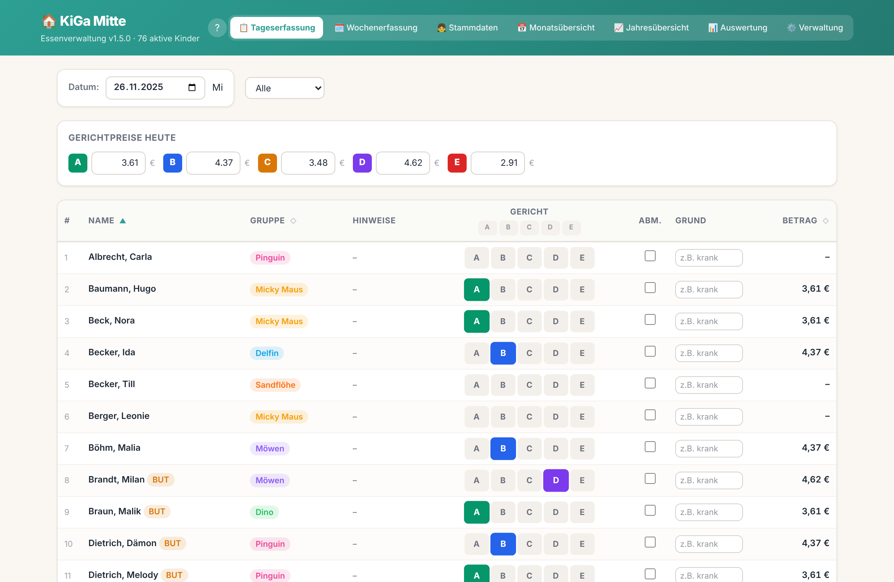
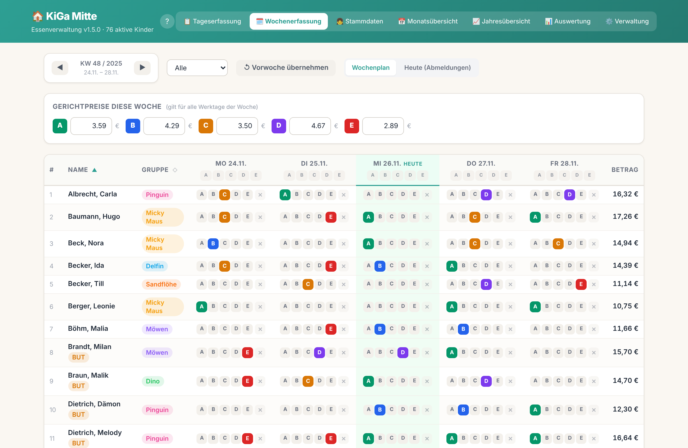
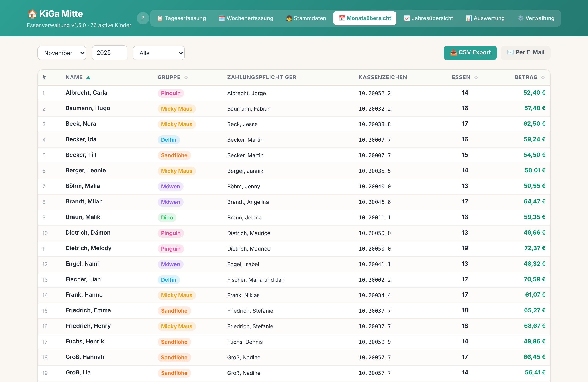
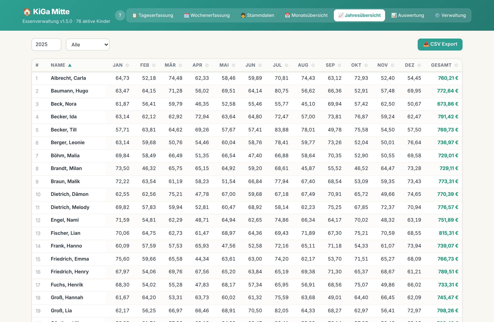
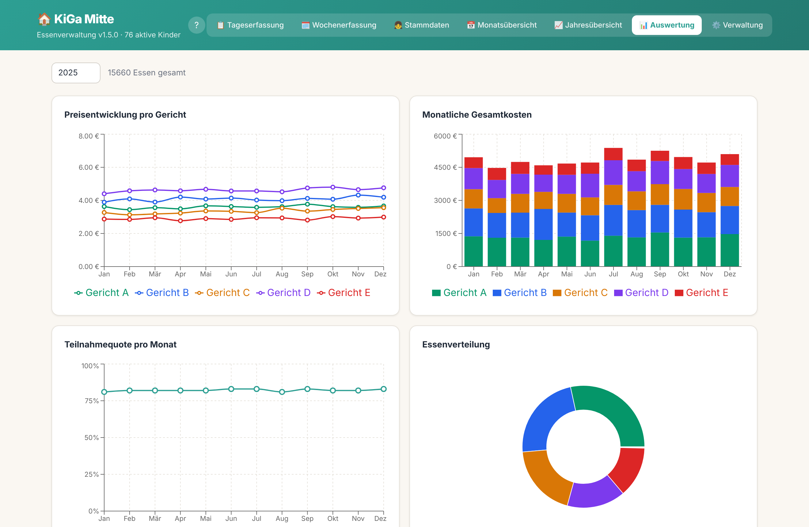
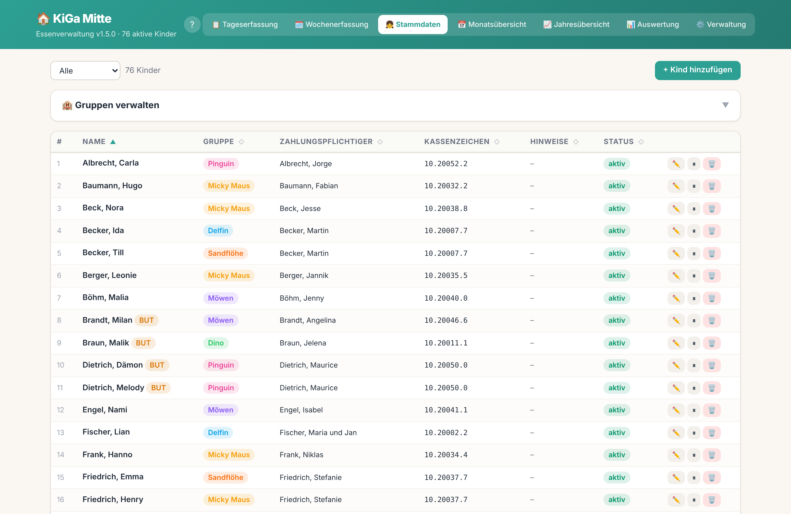
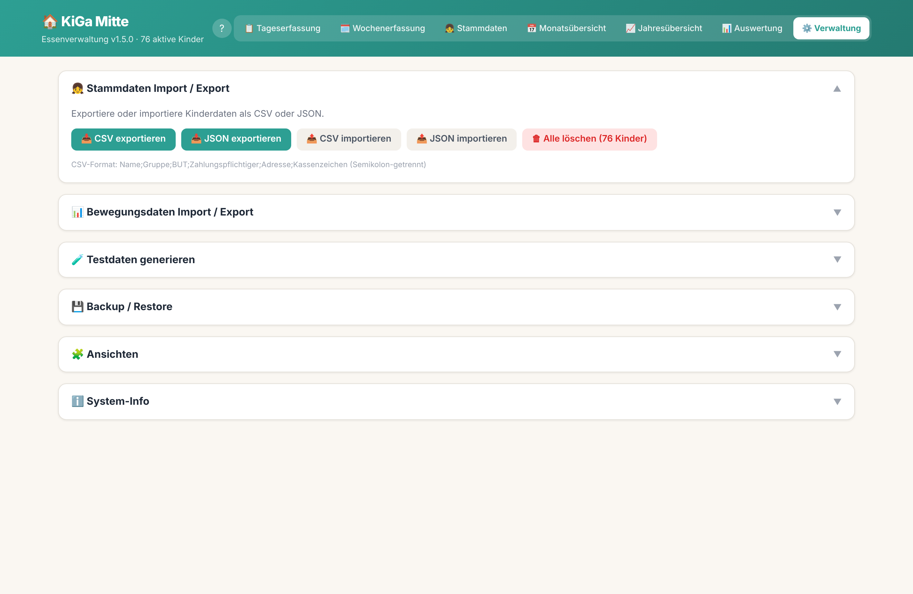
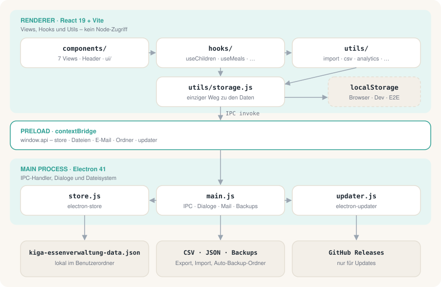

<div align="center">


# KiGa Essenverwaltung

**Essenskosten im Kindergarten erfassen – ohne Excel, ohne Cloud, ohne Vorkenntnisse.**<br>
Eine Desktop-App für Windows und macOS, die Tagesauswahl, Abmeldungen, Monatsabrechnung und Auswertungen an einem Ort bündelt und alle Daten lokal auf dem Rechner behält.

[](https://github.com/nimble-123/kiga-meal-manager/releases/latest)
[](https://github.com/nimble-123/kiga-meal-manager/releases)
[](https://github.com/nimble-123/kiga-meal-manager/actions/workflows/ci.yml)
[](LICENSE)
<br>
[](#installation)
[](#installation)
[](https://www.electronjs.org)
[](https://react.dev)
[](https://vite.dev)
[](#warum)
[](https://www.conventionalcommits.org/de/v1.0.0/)

[Warum](#warum) · [Features](#features) · [Installation](#installation) · [Erste Schritte](#erste-schritte) · [Architektur](#architektur) · [Entwicklung](#entwicklung) · [Changelog](CHANGELOG.md) · [Lizenz](#lizenz)

<br>



</div>

<br>

## Warum

Im KiGa Mitte wurde das Mittagessen jahrelang in einer Excel-Tabelle abgerechnet: ein Blatt pro Monat,
Formeln, die beim Kopieren brechen, und am Monatsende Handarbeit für jede Familie. Diese App ersetzt das.

- **Ohne Vorkenntnisse bedienbar.** Ein Klick pro Kind und Tag, eine geführte Tour beim ersten Start, Tooltips an allen Bedienelementen.
- **Lokal und privat.** Keine Cloud, kein Server, kein Konto. Die Daten liegen in einer JSON-Datei im Benutzerordner.
- **Richtig gerechnet.** Tagespreise pro Gericht, Abmeldungen mit Grund, Feiertage und Wochenenden automatisch gesperrt.
- **Fertig für die Abrechnung.** Monatsübersicht pro Zahlungspflichtigem mit Kassenzeichen, als CSV oder direkt per E-Mail.
- **Sicher vor Datenverlust.** Vollbackup, automatische periodische Backups und Bestätigungsdialoge bei allem, was löscht.

## Features

<table>
<tr>
<td width="50%" valign="top">

### 📋 Tageserfassung
Gerichtpreise A–E für den Tag, darunter alle Kinder mit ihrer Auswahl. Abmeldungen mit Grund
(„krank“, „Urlaub“ …), Gruppenfilter und **Bulk-Zuweisung**: ein Gericht mit einem Klick an alle
sichtbaren, nicht abgemeldeten Kinder.

</td>
<td width="50%" valign="top">

### 🗓️ Wochenerfassung <sub>optional</sub>
Der Wochenplan als Matrix Kinder × Mo–Fr zum Eintragen im Voraus, mit „Vorwoche übernehmen“.
Standardmäßig ausgeblendet und in der Verwaltung unter **Ansichten** einschaltbar.

</td>
</tr>
<tr>
<td valign="top">

### 📅 Monats- und Jahresübersicht
Essen und Beträge pro Kind mit Zahlungspflichtigem und Kassenzeichen, aufgeschlüsselt nach
Gericht. Die Jahresübersicht zeigt alle zwölf Monate als Matrix. Export als CSV mit
Summenzeile oder Versand als E-Mail mit CSV-Anhang.

</td>
<td valign="top">

### 📊 Auswertung
Sechs interaktive Charts: Preisentwicklung, Monatskosten, Teilnahmequote, Essenverteilung,
Essen pro Kind nach Gruppe und BUT-Anteil (Bildung und Teilhabe).

</td>
</tr>
<tr>
<td valign="top">

### 👧 Stammdaten
Kinder anlegen, bearbeiten, aktivieren oder deaktivieren – mit Eintritt, Austritt, Hinweisen
und BUT-Kennzeichen. Gruppen werden direkt darüber verwaltet und bekommen automatisch eine Farbe.

</td>
<td valign="top">

### ⚙️ Verwaltung
CSV- und JSON-Import/-Export für Stamm- und Bewegungsdaten, Vollbackup und Wiederherstellung,
automatisches Backup in einen Ordner deiner Wahl, Testdaten-Generator und Ansichts-Einstellungen.

</td>
</tr>
</table>

Dazu: alle Tabellen per Klick auf die Spalte sortierbar, Gruppenfilter in jeder Ansicht, deutsche
Feiertage als Schließtage, Tastenkürzel für jeden Tab und **automatische Updates** über GitHub Releases.

<details>
<summary><b>Screenshots</b></summary>
<br>

| | |
|---|---|
|  |  |
|  |  |
|  |  |

<sub>Die Screenshots entstehen mit <code>npm run screenshots</code> aus den Beispieldaten in <code>data/sample/</code>.</sub>

</details>

## Installation

Die Installer kommen aus dem [neuesten Release](https://github.com/nimble-123/kiga-meal-manager/releases/latest).

| Plattform | Datei | Hinweis |
|---|---|---|
| **Windows** – Installer | `KiGa Essenverwaltung Setup <version>.exe` | Installiert ohne Rückfrage für den aktuellen Benutzer, mit Desktop-Verknüpfung und automatischen Updates |
| **Windows** – Portable | `KiGa Essenverwaltung <version>.exe` | Ohne Installation, z. B. vom USB-Stick |
| **macOS** | `KiGa Essenverwaltung-<version>.dmg` | App in den Programme-Ordner ziehen |

Updates meldet die installierte App selbst: Ein Banner bietet die neue Version zum Herunterladen an und installiert sie per *Neu starten* oder beim nächsten Beenden.

> [!IMPORTANT]
> Die Builds sind noch nicht signiert. Windows SmartScreen zeigt beim ersten Start eine Warnung – **Weitere Informationen → Trotzdem ausführen**.
> macOS blockiert den ersten Start; unter **Systemeinstellungen → Datenschutz & Sicherheit → Dennoch öffnen** freigeben.

## Erste Schritte

Beim ersten Start ist die App leer und eine **geführte Tour** stellt alle Bereiche vor. Danach:

1. **Kinder importieren** – `data/sample/kinder.csv` enthält Beispieldaten im passenden Format (Semikolon-getrennt).
2. **Oder einzeln anlegen** – über *Kind manuell anlegen* bzw. den Tab **Stammdaten**.
3. **Preise eintragen und loslegen** – in der Tageserfassung die Gerichtpreise setzen und pro Kind ein Gericht wählen.

Zum Ausprobieren erzeugt die **Verwaltung** realistische Testdaten für vergangene Monate. Die Tour lässt sich jederzeit über den **?**-Button im Header erneut starten.

<details>
<summary><b>Tastenkürzel</b></summary>
<br>

| Kürzel | Tab |
|---|---|
| <kbd>Ctrl</kbd>/<kbd>⌘</kbd> + <kbd>1</kbd> | Tageserfassung |
| <kbd>Ctrl</kbd>/<kbd>⌘</kbd> + <kbd>2</kbd> | Wochenerfassung (nur wenn aktiviert) |
| <kbd>Ctrl</kbd>/<kbd>⌘</kbd> + <kbd>3</kbd> | Stammdaten |
| <kbd>Ctrl</kbd>/<kbd>⌘</kbd> + <kbd>4</kbd> | Monatsübersicht |
| <kbd>Ctrl</kbd>/<kbd>⌘</kbd> + <kbd>5</kbd> | Jahresübersicht |
| <kbd>Ctrl</kbd>/<kbd>⌘</kbd> + <kbd>6</kbd> | Auswertung |
| <kbd>Ctrl</kbd>/<kbd>⌘</kbd> + <kbd>7</kbd> | Verwaltung |

</details>

<details>
<summary><b>Wo liegen meine Daten?</b></summary>
<br>

Alles steht in `kiga-essenverwaltung-data.json` im Benutzerordner der App – unter Windows in `%APPDATA%`,
unter macOS in `~/Library/Application Support`. Den genauen Pfad zeigt die **Verwaltung** unter *System-Info*.
Eine Internetverbindung braucht die App nur für Updates.

</details>

## Architektur

<div align="center">
  <picture>
    <source media="(prefers-color-scheme: dark)" srcset="docs/assets/architecture-dark.svg">
    
  </picture>
</div>

Ein paar Regeln halten die Codebasis übersichtlich:

- **Ein Weg zu den Daten.** Jeder Zugriff läuft über `src/utils/storage.js`. In Electron geht er per IPC an `electron-store`, im Browser an `localStorage` – so laufen Dev-Server und E2E-Tests ohne Electron.
- **Kein Node im Renderer.** Die Oberfläche sieht nur die schmale `window.api` aus `electron/preload.js`.
- **State in Hooks, nicht in einem Store.** `useChildren` und `useMeals` halten die Daten in `App.jsx` und reichen sie als Props weiter.
- **Rohdaten statt Summen.** Gespeichert werden Preise und Auswahl pro Tag (`meals-YYYY-MM`); Monats- und Jahressummen werden beim Anzeigen berechnet.

Mehr Details zu Datenformat, IPC-Kanälen und Konventionen stehen in [CLAUDE.md](CLAUDE.md).

## Entwicklung

Voraussetzung ist [Node.js](https://nodejs.org/) 24 (wie in CI).

```bash
npm install
npm run dev          # Vite-Dev-Server + Electron mit Hot Reload
```

<details>
<summary><b>Alle Befehle</b></summary>
<br>

| Befehl | Zweck |
|---|---|
| `npm run dev` | Vite-Dev-Server und Electron im Entwicklungsmodus |
| `npm run build` | Production-Build nach `dist/` |
| `npm test` | Unit- und Integrationstests (Vitest + React Testing Library) |
| `npm run test:e2e` | E2E-Tests (Playwright gegen den Vite-Dev-Server) |
| `npm run test:all` | Beides nacheinander |
| `npm run test:watch` | Vitest im Watch-Modus |
| `npm run package` | Windows-Installer und Portable nach `release/` |
| `npm run package:mac` | macOS-DMG nach `release/` |
| `npm run screenshots` | README-Screenshots neu erzeugen (Beispieldaten, festes Datum) |
| `npm run architecture` | Architektur-Grafik neu zeichnen |

`npm run screenshots` nutzt Playwrights Chromium; einen anderen Browser gibt `CHROMIUM_PATH=/pfad/zu/chrome` vor.

</details>

<details>
<summary><b>Projektstruktur</b></summary>
<br>

```
electron/          Main Process: main.js, preload.js, store.js, updater.js
src/
  components/      Views (Tages-, Wochenerfassung, Übersichten, Auswertung, Verwaltung) + ui/
  hooks/           useChildren, useMeals, useWeekView, useAutoBackup, useTour, …
  utils/           storage, import/export, CSV, E-Mail, Analytics, Testdaten
  data/            Feiertage, Child-Factory
tests/             Vitest: unit/ und integration/
e2e/               Playwright
data/sample/       Beispiel-CSV für den Erstimport
scripts/           Screenshots und Architektur-Grafik
```

</details>

### Releases

Commits und PR-Titel folgen [Conventional Commits](https://www.conventionalcommits.org/de/v1.0.0/) und werden squash-gemergt.
[release-please](https://github.com/googleapis/release-please) pflegt daraus einen Release-PR mit Version und [Changelog](CHANGELOG.md).
Sobald er gemergt ist, baut GitHub Actions die Windows- und macOS-Pakete und hängt sie an das Release – von dort holt sich auch der Auto-Updater neue Versionen.

## Mitwirken

Issues und Pull Requests sind willkommen.

1. Einen Branch von `main` anlegen, z. B. `feat/<issue>-<kurzname>` oder `fix/<issue>-<kurzname>`.
2. UI-Texte auf Deutsch, Beträge über `fmtEuro()`, Speicherzugriffe nur über `storage.js`.
3. Vor dem Push `npm test` und `npm run test:e2e` laufen lassen – CI prüft beides plus den Build.
4. PR-Titel im Conventional-Commits-Format, z. B. `feat: …` oder `fix: …`.

## Lizenz

[MIT](LICENSE) © 2026 Nils Lutz

<br>

<p align="center">
  <sub>Gebaut für den KiGa Mitte · mit <a href="https://claude.com/claude-code">Claude Code</a></sub>
</p>
